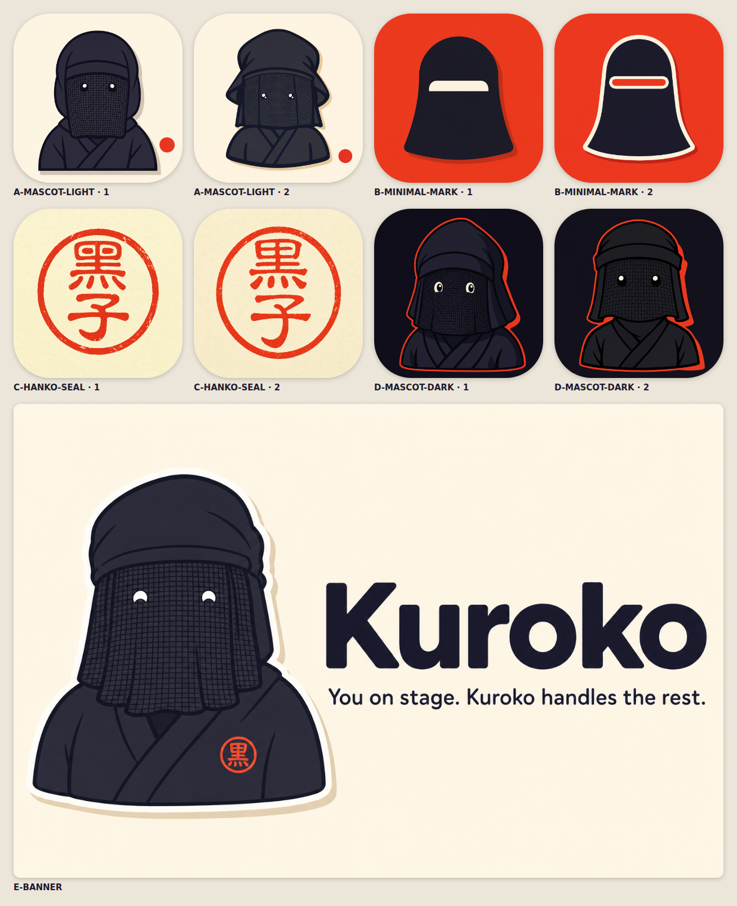

# Kuroko brand concepts

Generated with the OpenAI Images API (`gpt-image-2`, quality high) for issue #320. Prompts below.

## a-mascot-light

App icon: full-bleed opaque square background edge to edge, no rounded corners, no border, no transparency. The subject sits inside the central 70% of the square and stays legible at 32 pixels. A kuroko, the kabuki stagehand dressed all in black: a black hood (zukin) with a thin black mesh veil hanging over the face. A chunky, cute, friendly kuroko head and shoulders, two small friendly white eyes glinting through the dark veil, on a plain warm cream (#fff6e5) background. A small vermilion round seal dot is the only accent. No text. Flat vector illustration, sticker-like: bold dark outlines, flat colours, one hard offset shadow. Palette: ink black #1e1b2e, warm cream paper #fff6e5, a single vermilion accent #e8432e (the red of a Japanese hanko seal). No photorealism, no heavy gradients, no glossy 3D, no watermark.

## b-minimal-mark

App icon: full-bleed opaque square background edge to edge, no rounded corners, no border, no transparency. The subject sits inside the central 70% of the square and stays legible at 32 pixels. Minimal geometric logo mark: the silhouette of a kuroko hood as a single rounded black arch with one horizontal slit where the veil is, centred on a solid vermilion (#e8432e) background. Extremely simple, two colours only, no text. Flat vector illustration, sticker-like: bold dark outlines, flat colours, one hard offset shadow. Palette: ink black #1e1b2e, warm cream paper #fff6e5, a single vermilion accent #e8432e (the red of a Japanese hanko seal). No photorealism, no heavy gradients, no glossy 3D, no watermark.

## c-hanko-seal

App icon: full-bleed opaque square background edge to edge, no rounded corners, no border, no transparency. The subject sits inside the central 70% of the square and stays legible at 32 pixels. A vermilion round Japanese hanko seal stamp containing the two kanji 黒子 written in seal-script strokes, slightly imperfect ink as if really stamped by hand, centred on warm cream paper (#fff6e5) with subtle paper texture. No other text. Flat vector illustration, sticker-like: bold dark outlines, flat colours, one hard offset shadow. Palette: ink black #1e1b2e, warm cream paper #fff6e5, a single vermilion accent #e8432e (the red of a Japanese hanko seal). No photorealism, no heavy gradients, no glossy 3D, no watermark.

## d-mascot-dark

App icon: full-bleed opaque square background edge to edge, no rounded corners, no border, no transparency. The subject sits inside the central 70% of the square and stays legible at 32 pixels. A kuroko, the kabuki stagehand dressed all in black: a black hood (zukin) with a thin black mesh veil hanging over the face. A chunky, cute, friendly kuroko head and shoulders, two small friendly white eyes glinting through the dark veil, on a plain deep ink (#17151f) background, separated from the background by a vermilion rim light and outline. No text. Flat vector illustration, sticker-like: bold dark outlines, flat colours, one hard offset shadow. Palette: ink black #1e1b2e, warm cream paper #fff6e5, a single vermilion accent #e8432e (the red of a Japanese hanko seal). No photorealism, no heavy gradients, no glossy 3D, no watermark.

## e-banner

Wide social banner on warm cream paper (#fff6e5). On the left, A kuroko, the kabuki stagehand dressed all in black: a black hood (zukin) with a thin black mesh veil hanging over the face. a chunky, cute, friendly kuroko head and shoulders with two small white eyes glinting through the veil and a small vermilion seal dot. On the right, the wordmark "Kuroko" in a bold, clean, rounded sans-serif in ink black, and below it the tagline "You on stage. Kuroko handles the rest." in smaller type. Spell every word exactly. Generous margins. Flat vector illustration, sticker-like: bold dark outlines, flat colours, one hard offset shadow. Palette: ink black #1e1b2e, warm cream paper #fff6e5, a single vermilion accent #e8432e (the red of a Japanese hanko seal). No photorealism, no heavy gradients, no glossy 3D, no watermark.

