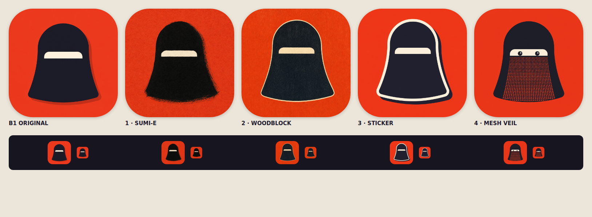

# B1 style iterations

Edits of `../b-minimal-mark-1.png` with the OpenAI Images API (`gpt-image-2`). The dark strip shows each at 64 and 32 px.

## b1-sumi-ink

Redraw this app icon keeping exactly the same composition, proportions and colours (black rounded-arch hood with one horizontal cream slit, centred on a solid vermilion square), but in Japanese sumi-e ink style: the hood painted with confident black brush strokes, visible dry-brush texture on its edges, the slit left as unpainted negative space, the vermilion background like washi paper with a faint fibre texture. Full-bleed opaque square, no rounded corners, no border, no text. Must stay legible at 32 pixels.

## b2-woodblock

Redraw this app icon keeping exactly the same composition, proportions and colours (black rounded-arch hood with one horizontal cream slit, centred on a solid vermilion square), but as a Japanese woodblock print (hanga / ukiyo-e): flat inks with slight misregistration, subtle wood-grain texture in the black and the vermilion, crisp carved edges, a thin cream keyline around the hood. Full-bleed opaque square, no rounded corners, no border, no text. Must stay legible at 32 pixels.

## b3-sticker

Redraw this app icon keeping exactly the same composition, proportions and colours (black rounded-arch hood with one horizontal cream slit, centred on a solid vermilion square), as a crisp modern vector sticker in a neo-brutalist style: perfectly smooth geometry, a thick cream outline around the hood, a hard offset drop shadow in deep ink (#1e1b2e) down and to the right, no texture, no gradients. Full-bleed opaque square, no rounded corners, no border, no text. Must stay legible at 32 pixels.

## b4-mesh-veil

Redraw this app icon keeping exactly the same composition, proportions and colours (black rounded-arch hood centred on a solid vermilion square), and make it unmistakably a kabuki kuroko stagehand: the lower part of the hood becomes a fine black mesh veil (a subtle grid texture hanging over the face), and inside the cream slit two small friendly round eyes in deep ink peek out. Flat vector style, bold shapes, no gradients. Full-bleed opaque square, no rounded corners, no border, no text. Must stay legible at 32 pixels.

