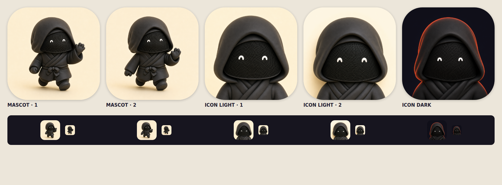

# Kuroko chibi

Edits of `../new-forms/n4-clay-chibi.png` without the papers and the stamp: the mascot and the app icon (OpenAI Images API, `gpt-image-2`). The dark strip shows each at 64 and 32 px.

## c1-mascot

Keep this exact character, material and lighting: the tiny chibi kuroko stagehand as a soft matte clay or vinyl designer toy, round chunky proportions, black hood and robe, black mesh veil over the face with two small friendly white eyes glinting behind it. Remove the stack of papers and the stamp: his hands are now free, one raised in a cheerful little wave, the other relaxed, standing in a light, confident pose. Same plain warm cream (#fff6e5) background and soft ground shadow. No props, no text.

## c2-icon-light

Turn this character into an app icon. Keep the same chibi kuroko as a soft matte clay or vinyl toy (black hood, black mesh veil, two small friendly white eyes glinting behind it), but show only his head and shoulders, large and centred, filling the central 70% of the square, facing the viewer. No papers, no stamp, no hands. Simplify the details so it reads at 32 pixels: a clean rounded hood silhouette, a clear veil and bright eyes. Plain warm cream (#fff6e5) background with a soft shadow. Full-bleed opaque square, no rounded corners, no border, no text.

## c3-icon-dark

Turn this character into a dark-mode app icon. Keep the same chibi kuroko as a soft matte clay or vinyl toy (black hood, black mesh veil, two small friendly white eyes glinting behind it), but show only his head and shoulders, large and centred, filling the central 70% of the square, facing the viewer. No papers, no stamp, no hands. Plain deep ink (#17151f) background; a warm vermilion (#e8432e) rim light outlines the hood so it separates from the background. Simplify the details so it reads at 32 pixels. Full-bleed opaque square, no rounded corners, no border, no text.

