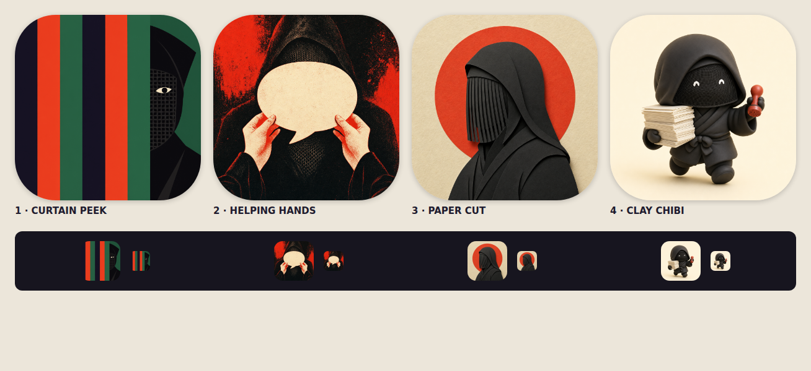

# New Kuroko forms

Four new forms and styles of the kuroko character, generated with the OpenAI Images API (`gpt-image-2`). The dark strip shows each at 64 and 32 px.

## n1-curtain-peek

App icon. A kabuki theatre curtain (joshiki-maku) of bold vertical stripes in ink black (#1e1b2e), persimmon vermilion (#e8432e) and deep green, fills the square; from behind its right edge a kuroko stagehand peeks out, only half of his black hooded head visible, the black mesh veil over his face and one small friendly cream eye showing through. Flat geometric graphic style, mid-century Japanese poster, crisp shapes, no gradients, no outlines. Full-bleed opaque square, no rounded corners, no border, no text. Legible at 32 pixels.

## n2-helping-hands

App icon. Seen from the front: two black-sleeved hands of a kuroko stagehand reach in from the bottom edge, discreetly holding up and presenting a single cream speech bubble, as if passing a line to an actor on stage; behind them, barely visible, the dark hooded figure with its mesh veil fades into the ink background. Two-colour risograph print: ink black and vermilion (#e8432e) on warm cream paper (#fff6e5), visible grain and slight misregistration, bold simple shapes. Full-bleed opaque square, no rounded corners, no border, no text. Legible at 32 pixels.

## n3-paper-cut

App icon. A kuroko stagehand's head and shoulders in three-quarter view made of layered cut paper (kirigami): stacked sheets of black paper for the hood and robe, the face veil as thin vertical strips of black paper slightly lifted, a soft real shadow between each layer giving depth, a vermilion (#e8432e) paper circle behind the head like a rising sun, on a warm cream paper background. Tactile, handmade, photographed from the front with even soft light. Full-bleed opaque square, no rounded corners, no border, no text. Legible at 32 pixels.

## n4-clay-chibi

App icon. A tiny chibi kuroko stagehand, full body, as a soft matte clay or vinyl designer toy: round chunky proportions, black hood and robe, a black mesh veil over the face with two small friendly white eyes glinting behind it, happily carrying a tall stack of papers in one arm and holding a little vermilion hanko seal stamp in the other hand. Soft studio lighting, gentle shadow on the ground, plain warm cream (#fff6e5) background, cute and confident. Full-bleed opaque square, no rounded corners, no border, no text. Legible at 32 pixels.

